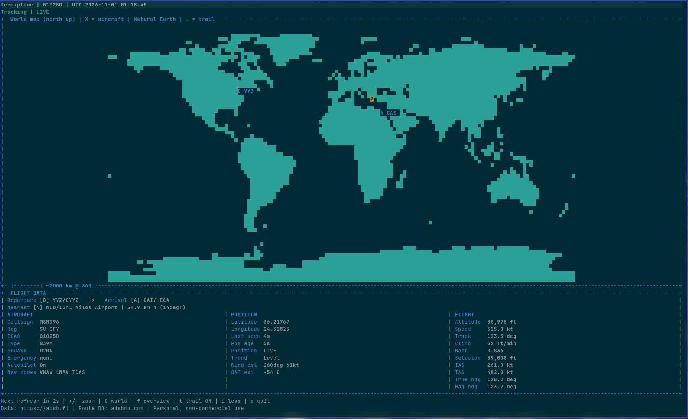
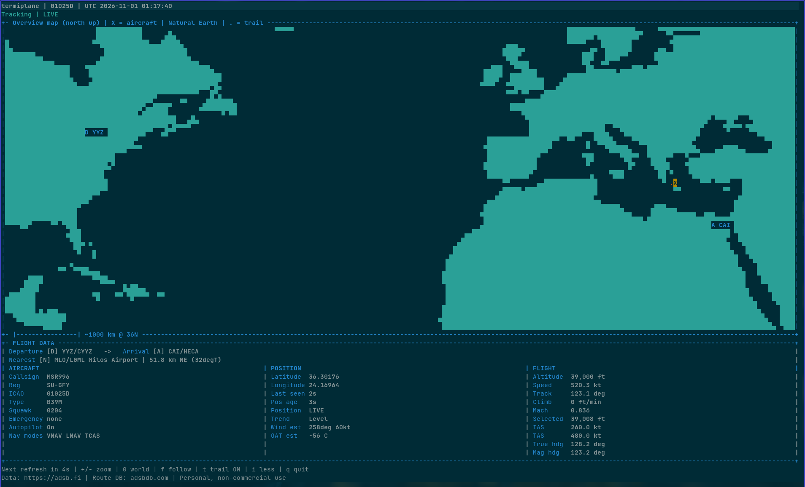
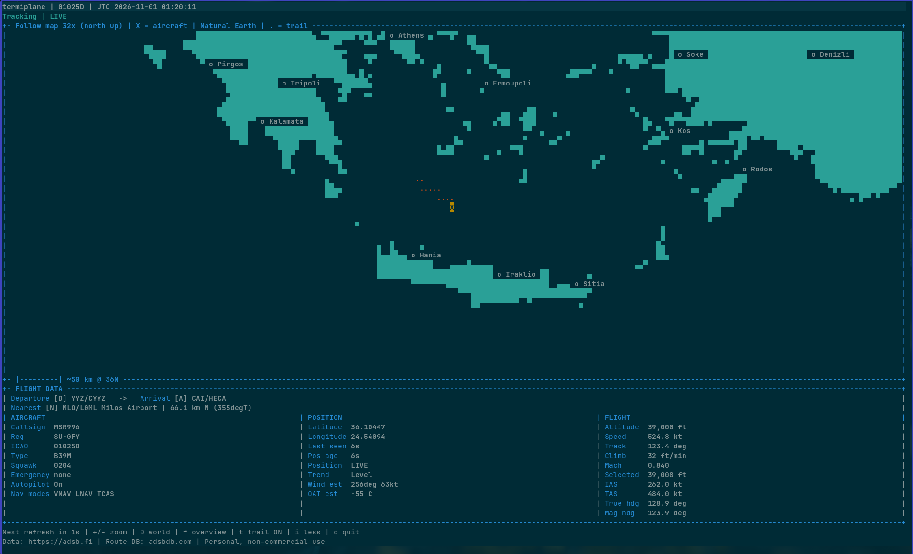
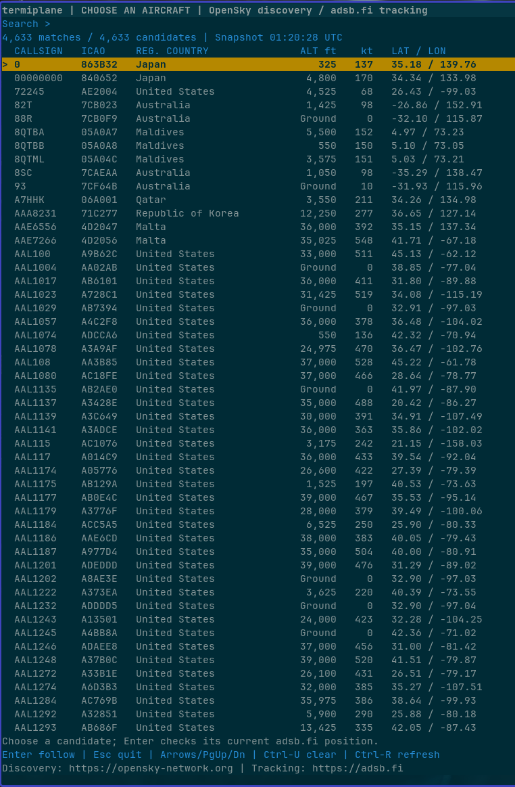

# termiplane

```text
 >_  _____ _____ ____  __  __ ___ ____  _        _    _   _ _____
    |_   _| ____|  _ \|  \/  |_ _|  _ \| |      / \  | \ | | ____|
      | | |  _| | |_) | |\/| || || |_) | |     / _ \ |  \| |  _|
      | | | |___|  _ <| |  | || ||  __/| |___ / ___ \| |\  | |___
      |_| |_____|_| \_\_|  |_|___|_|   |_____/_/   \_\_| \_|_____|
```



I'm scared of flying. Turns out I'm even more scared when my partner is the one on
the plane. He was heading somewhere far, far away from France, and I wanted to
follow his flight from my terminal while I was at work.

So I built **termiplane**. To be fair, when I say "I build", Codex helped a lot.

Follow one aircraft live in your terminal. Python 3.10+, no runtime dependencies,
no account, and no API key.

The termiplane code is licensed under the [MIT License](LICENSE). Bundled map
and airport data retain their public-domain terms; see
[map data provenance](termiplane_maps/README.md). The MIT license applies to
the project code and does not change the personal, non-commercial terms of the
live ADS-B services.

```sh
python3 -m venv .venv
.venv/bin/python -m pip install .
.venv/bin/termiplane
```

Or run directly without installing:

```sh
python3 termiplane.py FIN40T
python3 termiplane.py OH-LKK
python3 termiplane.py 461E1A --interval 10
python3 termiplane.py 461E1A --once
```

Run `termiplane` (or `python3 termiplane.py`) **without an argument** to open the
aircraft picker. Type a fuzzy search for a callsign, ICAO hex, or
registration country (`fn4t` can match `FIN40T`). Use arrows and Page Up/Down to
browse, **Enter** to follow, **Ctrl-U** to clear the search, **Ctrl-R** to refresh,
and **Esc** or **Ctrl-C** to cancel. The list shows callsign, hex, registration
country, altitude in feet, speed in knots, and coordinates, as space permits.

Discovery uses [OpenSky's public global state snapshot](https://openskynetwork.github.io/opensky-api/rest.html),
including aircraft with positions no older than 30 seconds. This is a snapshot,
not a list of every aircraft in the world or a guaranteed complete list of
adsb.fi coverage. OpenSky does not supply registration numbers or aircraft types
in this endpoint, so those cannot be searched in the picker. Enter checks the
selected hex against adsb.fi and opens the dashboard only when it has a fresh
position; otherwise the picker stays open. Tracking then uses the same adsb.fi
feed as direct arguments.

Downloads and selection checks run in the background. Refreshes are manual and
at least 30 seconds apart; rate-limit responses show an error and honor the
server's retry delay. OpenSky anonymous daily quotas also apply. The picker
requires an interactive curses terminal; supply an identifier for `--once`,
redirected output, or terminals without curses. Direct callsign/registration/hex
arguments continue to work without using OpenSky.

Replace these examples with an aircraft currently in coverage. Refresh defaults
to five seconds; `q` or `Ctrl-C` quits the dashboard, and **Esc** returns to the
aircraft picker. From the picker, **Esc** cancels and exits. The terminal is
restored on exit. Redirected output
contains plain snapshots without terminal escape sequences. `--once` prints one
snapshot and exits with status 1 if the lookup fails or no aircraft is found.

The dashboard shows callsign, registration, ICAO address, aircraft type, latitude
and longitude, barometric altitude (feet), ground speed (knots), track (degrees),
vertical rate (feet/minute), squawk, emergency status, and report/position ages.
The main panel also shows **Trend**, **Mach**, and **Selected** altitude. Trend is
climbing above +100 ft/min, descending below -100 ft/min, level within that band,
or ground when reported. Selected altitude uses the MCP/FCU value, falling back
to the FMS value when needed; it is a selected target, not a clearance.
Departure and arrival airports appear together above the flight columns, using
IATA/ICAO codes (for example `HEL/EFHK -> ARN/ESSA`). Missing routes show `--`.
The next row shows the **Nearest** listed airport: identifier/name, approximate
horizontal great-circle distance (meters below 1 km, otherwise kilometers),
and direction from the aircraft to the airport. `degT` means degrees from true
north. Direction is `--` when the aircraft is exactly at the airport coordinates;
invalid or missing aircraft positions show `Nearest --`.
Missing fields appear as `--`; reports or positions older than 30 seconds are
marked stale. Track is the direction of travel, not aircraft heading.

Press **`i`** to expand or collapse additional information:

- Indicated and true airspeed (**IAS/TAS**, knots), alongside ground speed.
- **True hdg / Mag hdg**, explicitly distinguished in degrees.
- **Wind est / OAT est**, estimated wind direction/speed and outside air
  temperature in Celsius, calculated by the upstream decoder.
- Reported **Autopilot** state and engaged **Nav modes**.

Optional values depend on the aircraft and feed; unavailable data stays `--`.
An absent automation report is unknown, not treated as autopilot off. Expanded
information uses more rows; press `i` again to restore map space. These fields
come from the existing response and make no extra API requests. See the
[feed field definitions](https://github.com/wiedehopf/readsb/blob/dev/README-json.md).

The interactive dashboard uses Python's **curses / ncurses** interface with
[Solarized Dark](https://ethanschoonover.com/solarized/) (sorry, this is my favorite): a colored
world map fills the terminal, with a highlighted aircraft, status bar, and bordered
flight information panel along the bottom. `X` marks the aircraft
and `#` is land in the ASCII map;
north is at the top and west on the left. The dashboard resizes immediately,
updates report ages and the refresh countdown, and labels stale positions.
Network requests run in the background, so quitting and resizing remain responsive
even when the API is slow. Coastlines come from bundled
[Natural Earth map data](https://github.com/nvkelso/natural-earth-vector/tree/v5.1.2/geojson)
(v5.1.2, [public domain](https://www.naturalearthdata.com/about/terms-of-use/)),
including islands and inland-water cutouts. UTF-8 terminals use half-block cells
for smoother coastlines, with proportions adjusted for the tall terminal cells.
The map is centered within the available area instead of stretching continents.
The raster is cached for each window size and map viewport.
No extra requests or dependencies are needed. Very small windows may not have
room for the map or every field; enlarge the terminal to see everything.

Colorless terminals use bold/reverse highlighting. Non-UTF-8 terminals use an
ASCII land mask. `--once`, redirected output,
and `TERM=dumb` use plain text. Curses is included with most Linux/macOS Python
installations; if the Python installation lacks curses (including standard Windows
Python), the app uses plain text without requiring another package.
Solarized RGB colors are applied when the terminal supports changing its palette,
and restored on exit. Other color terminals use the nearest available colors.

The flight panel groups aligned labels and values under **AIRCRAFT**, **POSITION**,
and **FLIGHT**. Narrow windows stack these sections. Labels use Solarized blue;
values use brighter text so the numbers are easier to scan.

Use `+` (or `=`) to zoom in, `-` to zoom out, and `0` to return to the world map.
Zoom ranges from 1x to 1024x. Zoomed views stay centered on the latest aircraft
position, wrap across the date line, and resize with the terminal. Zooming uses
the bundled map data and does not make extra API requests.

Press `f` to toggle **follow / overview**. Overview automatically fits the aircraft,
departure, arrival, and nearest airport, with padding and date-line wrapping.
Returning to follow restores your previous zoom; `+`, `-`, and `0` also return to
follow mode.

Blue airport markers use `D` for departure, `A` for arrival, and `N` for nearest,
with airport codes beside them (for example, `D HEL`). The flight panel shows the same letters.
Airports sharing a map cell use `+` and a combined label (for example, `+ D/N:HEL`);
`X` stays on top of airport markers, with their roles retained in the label.
The nearest airport marker appears only in a detailed follow map at **128x zoom
or higher**; the nearest airport name, distance, and bearing remain in the flight
panel at every zoom. Departure and arrival markers remain visible at all zooms.
Airports without a match in the bundled database
are omitted from the map. Departure and arrival still depend on the callsign
route database, which can be incomplete or outdated.

Map detail increases automatically as you zoom:

- World/2x: 1:110 million coastlines.
- 4x–8x: 1:50 million coastlines and `:` country borders.
- 16x–1024x: 1:10 million coastlines, including smaller islands and bays.
- From 8x: `o` city labels; more smaller cities become eligible from 32x.

Labels are spaced to reduce overlap and preserve the aircraft and trail. The
detailed layers and airport data are bundled (about 4.9 MB compressed) and loaded on first use.
See [map data provenance](termiplane_maps/README.md). These are generalized
geographic maps; street, building, and terrain detail is not included.

An orange dotted trail is **visible by default**. Press `t` to hide or show it;
recording continues while hidden. It keeps the full observed flight
and `X` marks the current aircraft. The dots
connect successive observations; gaps longer than a minute break the line.
The trail follows the map when zooming and resizing, and handles the date line.
Zoom in to see short movements.

The trail records positions from when you start tracking. It stays in memory
and is not saved after exit.

A horizontal distance scale appears along the map's bottom border, for example
`|--------| ~500 km @ 60N`. Distances are approximate **kilometers**, switching
to **meters** below 1 km, measured
at the aircraft's latitude (or the equator when no position is available).
The scale adjusts for zoom, window size, and latitude. It is hidden in very
narrow windows and marked unavailable at the poles, where longitude converges.

## Identifiers

Six hexadecimal characters select an ICAO address. Identifiers containing a
hyphen, or beginning with `N` followed by a digit, select a registration.
Everything else selects a callsign. Override ambiguous identifiers explicitly:

```sh
python3 termiplane.py ABC123 --by callsign
python3 termiplane.py CFTNO --by registration
```

Use the aircraft's **broadcast callsign** (e.g. `BAW123`), which may differ from
the ticket's flight number (`BA123`). Once found, termiplane locks onto the
aircraft's ICAO address so a callsign change cannot switch to another plane.
Multiple matches require a more specific ICAO lookup.

## Data and availability

Data is provided by [adsb.fi](https://adsb.fi) through its
[public API](https://github.com/adsbfi/opendata). The API is keyless, allows one
request per second, and permits **personal, non-commercial use only**. See the
provider's linked terms before use. `--interval` cannot be less than one second.

Airport routes come from the free, keyless
[adsbdb callsign API](https://github.com/mrjackwills/adsbdb). The app looks up the
aircraft's broadcast callsign in the background and caches the result for the
run, including unavailable results. A callsign change clears the previous route
and triggers a new lookup. Route failures never stop live tracking; a request
times out after five seconds. Plain-text snapshots also include the airports.
Routes are database associations, not verified live flight plans: reused
callsigns, outdated records, diversions, and private flights can produce missing
or incorrect airports.

Nearest-airport results use a bundled [OurAirports](https://ourairports.com/data/)
snapshot from 2026-10-31. It includes listed small, medium, and large airports;
closed sites, heliports, seaplane bases, and balloonports are excluded. It does
not require network access. The closest result is geographic proximity, not an
assessment of runway size, access permissions, or suitability for landing.

Coverage depends on volunteer receivers and aircraft transmissions. No match
can mean an aircraft is offline, outside coverage, or has a different callsign.
The app keeps retrying; any previous snapshot is clearly marked as last known.
Network failures back off up to 60 seconds (or longer when the server requests
it via `Retry-After`). HTTP 400/401/403/404 stop polling to avoid repeatedly
sending rejected requests. Requests time out after ten seconds. API availability
and terms can change. This data is not suitable for navigation.

## Tests

```sh
python3 -m unittest discover -s tests -v
```

Tests run offline with recorded-shape responses and simulated network failures.

## Alittle tour






